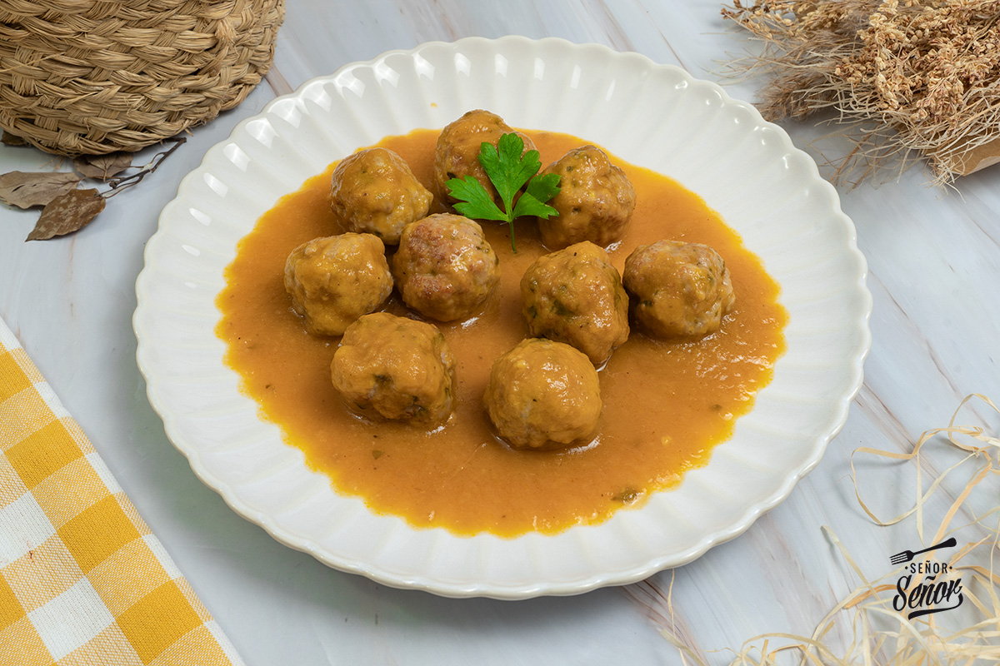

Albóndigas en salsa
===================

Ingredientes
------------

Albóndigas:

* 1 kg de carne picada (mezcla de ternera y cerdo)
* 2 rebanadas de pan de molde
* Leche (para mojar el pan)
* 1 diente de ajo
* Perejil fresco (un poco)
* 8 g de pan rallado (1 cucharada)
* 1 g de sal (1 pizca)

Salsa:

* 1 cebolla
* 2 zanahorias
* Caldo de carne o de pollo (para cubrir)
* 10 g de harina (1 cucharada)
* 15 g de tomate concentrado (1 cucharada)
* 1 g de sal (1 pizca)
* 1 hoja de laurel
* Pimienta recién molida
* Aceite de oliva virgen extra
* Vino blanco (1 vaso)

Preparación
-----------

1. Remojar en leche las rebanadas de pan de molde unos minutos.

2. En un bol, poner la carne, el pan remojado, el ajo picado, el perejil y las especias. Mezclar muy bien con las manos. Si la carne ha quedado algo líquida por la leche, añadir poco a poco pan rallado hasta conseguir una textura mejor.

3. Formar las albóndigas, de unos 35 g cada una, y pasarlas por harina.

4. Sellarlas a fuego fuerte en aceite de oliva. Terminarán de cocinarse en la salsa.

5. Para la salsa, pochar la cebolla y las zanahorias a fuego lento.

6. Una vez pochadas, añadir el tomate concentrado y la harina. Rehogar unos minutos.

7. Añadir el vino blanco y subir el fuego hasta que se evapore el alcohol.

8. Cubrir con el caldo y cocinar unos 20 minutos con la hoja de laurel.

9. Pasado el tiempo, triturar la salsa y pasarla por un colador para que quede muy fina.

10. Añadir las albóndigas a la salsa y cocinar unos 10 minutos, hasta que se hagan por dentro.

Trucos
------

* Usar carne picada mezcla de ternera y cerdo: el cerdo tiene más grasa y las albóndigas quedan más jugosas.

* El vino blanco se puede sustituir por brandy, coñac o vino rancio.

* Quedan muy bien con patatas fritas cortadas en cuadraditos o con arroz blanco.
