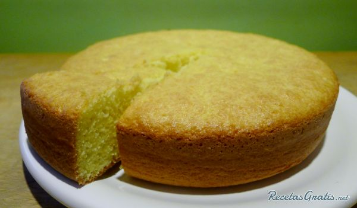

Bizcocho de limón
=================

Ingredientes
------------

* 3 huevos
* 250 g de yogur de limón (2 yogures)
* 125 ml de aceite (1 vaso de yogur)
* 220 g de azúcar (2 vasos de yogur)
* 225 g de harina (3 vasos de yogur)
* 15 g de levadura
* 1 g de sal (1 pizca)
* Ralladura de 1 limón

Preparación
-----------

1. Batir los huevos, yogures y azúcar e integrar bien.

2. Añadir el aceite y la ralladura del limón y mezclar bien.

3. Mezclar la harina, la levadura y la sal. Echar esta mezcla sobre la anterior, tamizándola y en tandas (unas 3 ó 4). Mezclar bien después de cada tanda

4. Poner mantequilla y harina en el molde y verter la mezcla. Meter en el horno, 180 °C 40 minutos, calor arriba y abajo. Pinchar con un palillo para ver si está listo
