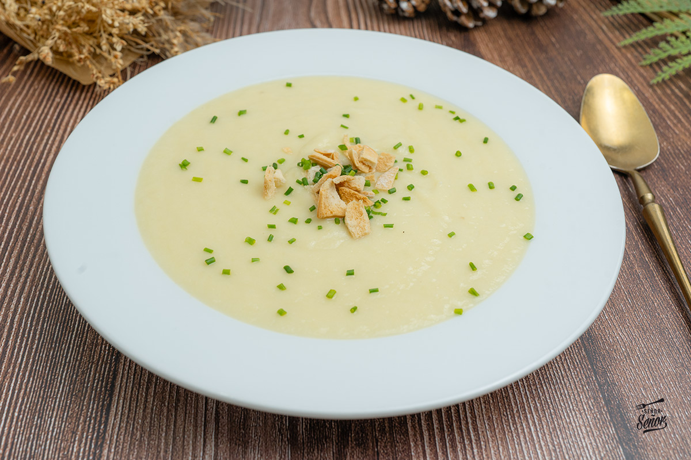

Crema de puerros
================

Ingredientes
------------

* 4 puerros
* 2 patatas
* Caldo de verduras o de pollo
* Sal
* Pimienta negra o blanca
* Aceite de oliva
* Mantequilla
* 100 ml de nata para cocinar

Preparación
-----------

1. Limpiar los puerros de arena: hacerles un corte en cruz y ponerlos debajo del grifo para retirar toda la arena. Pelar las patatas.

2. Cortar la parte verde de los puerros y picarlos en trozos medianos, junto con las patatas. No hace falta que sea en brunoise porque se va a triturar.

3. Rehogar el puerro y las patatas con un poco de mantequilla y aceite de oliva durante unos 20 minutos.

4. Cubrir las verduras con el caldo y cocer durante 20 minutos a fuego medio.

5. Colar las verduras, reservando el caldo. Ponerlas en el vaso de la batidora con la nata y triturar.

6. Añadir el caldo poco a poco hasta obtener la textura deseada. Salpimentar al gusto, teniendo en cuenta que el caldo ya aporta bastante sabor.

Trucos
------

* La mantequilla aporta cremosidad y sabor a la crema.

* En lugar de caldo se puede usar agua.

* Para una crema más ligera, sustituir la nata por leche evaporada.
