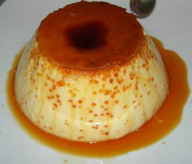

Flan de huevo
=============

Ingredientes
------------

Flan:

* 750 ml de leche
* 125 g de azúcar
* 6 huevos

Caramelo:

* 45 g de azúcar (3 cucharadas)
* 8 ml de agua (½ cucharada)

Preparación
-----------

1. Mezclar el azúcar y el agua del caramelo en un cazo y poner a fuego lento. Remover constantemente hasta que se tueste y conseguir el caramelo. Cubrir la base de la flanera con caramelo. **Importante**: Si nos pasamos de tiempo el caramelo se quema y el sabor no es dulce, hay que tener cuidado porque se quema muy rápidamente. El caramelo quema mucho, hay que tener especial cuidado con las salpicaduras.

2. Batir la leche, el azúcar y los huevos hasta que la mezcla quede bien integrada. Verter en la flanera sobre el caramelo. Poner la flanera sobre una bandeja con agua para que se haga al baño María y meter en el horno, 190 °C unos 50 minutos.
