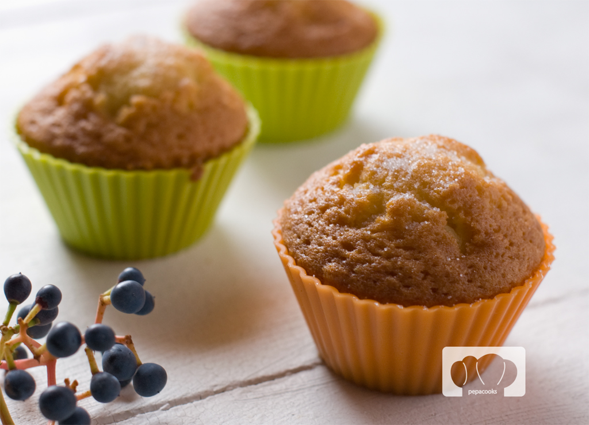

Magdalenas
==========

Ingredientes
------------

* 220 g de harina
* 200 g de azúcar
* 200 ml de aceite
* 70 ml de leche
* 4 huevos
* 10 g de levadura
* 5 ml de esencia de vainilla (1 cucharadita)
* 1 g de sal (1 pizca)

Preparación
-----------

1. Mezclar los huevos con el azúcar e integrar bien. Añadir el aceite y mezclar. Añadir después la leche y vainilla y mezclar bien

2. Mezclar la harina, levadura y sal en un recipiente aparte. Añadir esta mezcla a la masa tamizándola (pasándola por un colador) en tandas, integrando bien en cada tanda.

3. Poner la mezcla 3 cuartos de hora o una hora en la nevera. Calentar el horno a 210 °C. Poner los papeles de magdalenas en el molde y llenarlos a las 3/4 partes. Introducir en el horno unos 20-25 minutos, calor arriba y abajo.
